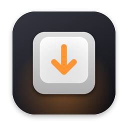
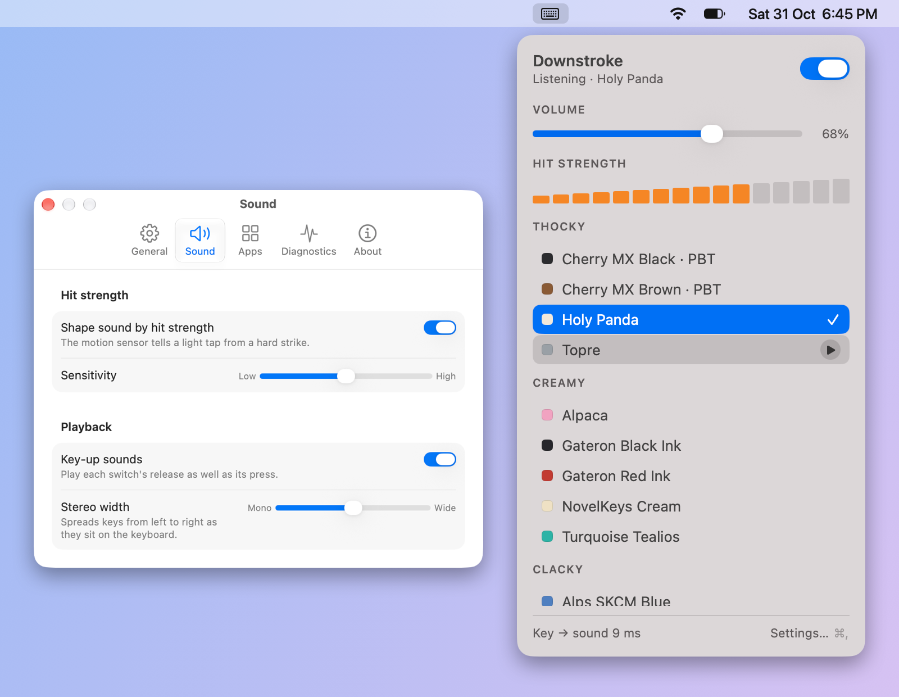
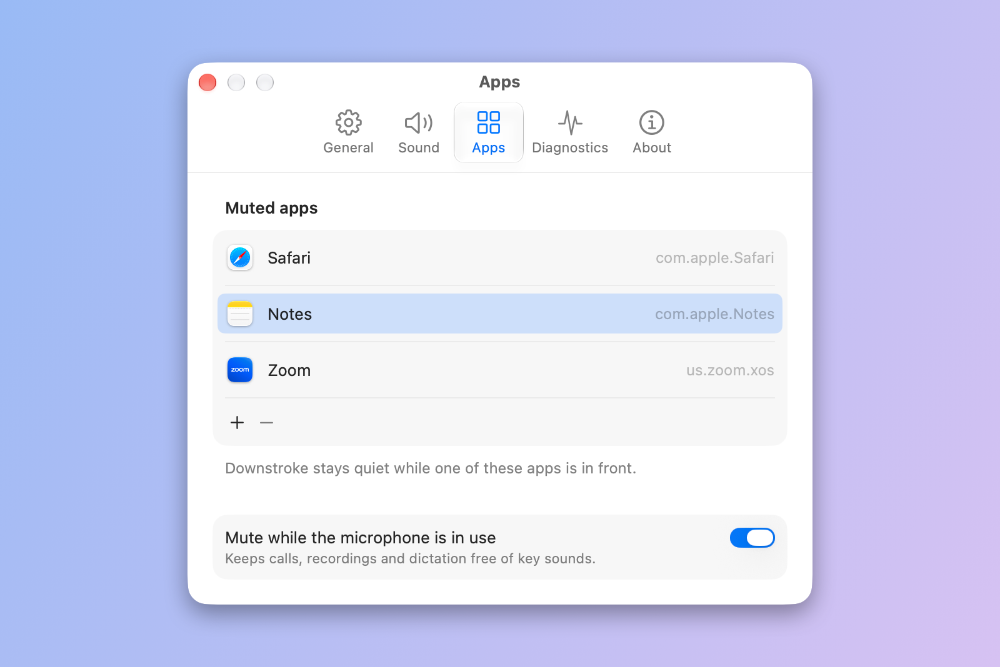
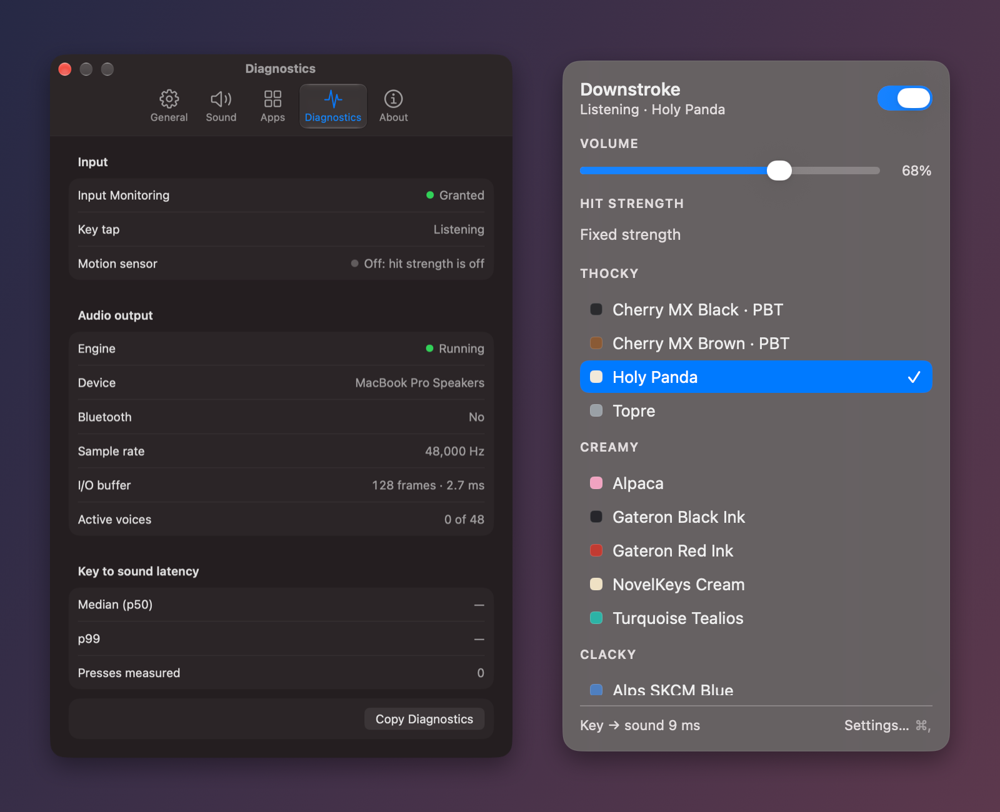

<div align="center">



# Downstroke

**Mechanical-keyboard sound for your MacBook, fast enough that you forget it's there.**




</div>

Downstroke lives in your menu bar and plays a real mechanical-switch recording every time you press a key. Pick from 20 boards, from thocky Holy Pandas to clacky Alps, and switch on the next keystroke.

It's built for a MacBook's built-in keyboard. The sound starts about 5 ms after the key event, and nothing about your typing is stored or leaves your Mac. It's a personal tool, not a product.

## Install

Downstroke needs macOS 27.

1. Download the latest `Downstroke-<version>.dmg` from [Releases](https://github.com/LeonardCooray/downstroke/releases/latest).
2. Open it and drag **Downstroke** into **Applications**.
3. Open Downstroke from Applications. It appears in the menu bar, not the Dock.

Downstroke is signed with a personal certificate rather than an Apple Developer ID, so macOS blocks the first launch. Click **Done** on that warning, then go to **System Settings › Privacy & Security**, scroll down to **Security** and click **Open Anyway** next to Downstroke. You only need to do this once.

There's no update check. To update, download the newer DMG and replace the app in Applications. Every release is signed with the same certificate, so Input Monitoring permission carries over.

**Input Monitoring.** Downstroke never prompts at launch. Open the menu bar panel and use the button there, which asks macOS for access and opens the Input Monitoring page in System Settings. If sounds don't start within a few seconds of allowing it, quit and reopen Downstroke, since macOS often applies a new grant only on relaunch. It never asks for Accessibility or the microphone.

## Features

**Real switches**

- 20 boards grouped by texture: Thocky, Creamy, Clacky, Crisp and Thump
- Hover a board or press its play button to audition it, and click to switch, effective on the next key
- Key-up sounds, so you hear each switch's release as well as its press
- Stereo placement by key position, with a width slider
- A small random pitch and gain variation on every press, so repeats don't sound robotic

**Quiet when it should be**

- Mute in the apps you choose, such as a meeting app or a notes app you dictate into
- Mute automatically while any app is using the microphone
- Toggle sound from anywhere with ⌃⌥⌘K



**Feel, if your Mac can sense it**

- Slam accent reads the MacBook's motion sensor, so a key hit much harder than usual sounds heavier
- A live meter in the panel shows each hit against the slam threshold
- See [Slam accent](#slam-accent) for what the sensor can and can't tell

**Fast, and honest about it**

- The panel shows your key-to-sound latency, and Settings › Diagnostics breaks it down with the engine, sensor, output and permission status
- When output is Bluetooth, the panel says "Bluetooth adds delay" rather than showing a misleading figure
- Light and dark mode follow the system



Autorepeat presses don't play.

## Keys

| Key | What it does |
|---|---|
| ⌃⌥⌘K | Turn Downstroke on or off from any app (you can change it in Settings) |
| ⌘, | Open Settings while the panel is open |
| Esc | Close the panel |

## Settings

Open **Settings…** from the panel to change:

- **General:** the on/off hotkey, launch at login (off by default, via `SMAppService`) and Quit
- **Sound:** slam accent and its threshold, key-up sounds and stereo width
- **Apps:** the muted apps list and mute while the microphone is in use
- **Diagnostics:** latency p50/p99, engine, sensor, output and permission status, with a button to copy it all
- **About:** the version, credits and licences

Output follows the system default device.

## Slam accent

Downstroke reads the MacBook's built-in accelerometer at about 800 Hz (no root needed) and, for each key press, looks at a window from 15 ms before to 8 ms after the key event. The strongest impact in that window, after a 5 Hz high-pass filter and with bumps above 0.3 g rejected, is compared with the slam threshold. Below it, the press plays exactly as it would with the accent off. Above it, the sound ramps to the heaviest layer, reaching it at 1.5× the threshold.

**Why slams only.** On the MacBook Pro (M5 Pro) it was built on, a raw-sensor recording showed the sensor can't tell ordinary soft typing from ordinary hard typing, but it reliably picks out a deliberate slam: at the default threshold it caught 13 of 16 slams and flagged 3 of 97 other presses. So Downstroke doesn't pretend to measure finer shades than that.

Each board has several real recordings of ordinary keys (5 to 26, depending on the pack) and usually one each for keys like space and return. At load, Downstroke derives four velocity layers (soft, medium, hard and slam) from every recording. Normal presses crossfade medium and hard; slams move toward the slam layer, which changes the brightness and weight of the sound, not its pitch or timing. Every press also gets a small random pitch (±3%) and gain (±10%) variation.

**Tuning.** Settings › Sound › Slam threshold runs from Hard to trigger (30 mg) to Easy to trigger (13 mg); the middle is 15.5 mg. The easy end stops at 13 mg because below that ordinary typing starts reading as slams. The panel meter puts the threshold at its centre tick, and bars past it light orange, so you can set it by eye. Settings › Diagnostics counts slams since launch.

**Checking the sensor.** `build/Downstroke.app/Contents/MacOS/Downstroke --probe` (run from a terminal) wakes the accelerometer, then asks for 20 soft presses and 20 slams, and passes when the default threshold catches at least 60% of the slams and at most 10% of the soft presses. Type the presses in another app such as TextEdit: a terminal with Secure Keyboard Entry on hides key presses from the listener.

**The trade-off.** To catch a slam, Downstroke has to wait for the key to bottom out, so with the accent on every sound starts about 8 ms later. Turn it off in Settings › Sound and the sound starts as soon as the key event arrives.

**No sensor, no dynamics.** On a desktop Mac, an Intel Mac, or with an external keyboard (which doesn't shake the laptop's case), there's nothing to measure. Downstroke plays every press at a fixed medium strength and says so in Settings › Diagnostics. It never fakes dynamics.

## Speed

The audio side is a lock-free real-time mixer: a fixed pool of 48 voices, all samples decoded into memory at startup, and a 128-frame I/O buffer request. Key events reach the render thread through a lock-free queue, and the render thread never allocates, waits, logs or touches the disk. When all voices are busy, the oldest is stolen.

After 60 seconds with no key press, no audition and nothing still sounding, the audio engine pauses (the motion sensor keeps running, so the slam accent still works). The next key restarts it without ever holding up the key listener. That one key still plays, late by the output device's restart time: about 35 ms on the built-in speakers (so about 37 ms from press to sound, against the usual 5 ms with the slam accent off or 14 ms with it on), and longer on Bluetooth. Every key after it is back to normal. Settings › Diagnostics shows the engine as Running, Paused (idle) or Off.

`build/Downstroke.app/Contents/MacOS/Downstroke --bench` replays synthetic key events through the real engine and pipeline and checks these budgets:

- Latency from key event to the start of the render cycle that plays it, p99: at most 3 ms plus the buffer with the slam accent off, and at most 8 + 3 ms plus the buffer with it on.
- Idle CPU: at most 1.0% of a core with the slam accent off (engine running), and 1.5% with it on, measured with the engine paused after the idle timeout (macOS's HID path for the 800 Hz sensor costs about 1% by itself).
- First key after an idle pause, from key event to the start of the render cycle that plays it, p99: at most 50 ms.
- Typing CPU: at most 3%.
- Memory: at most 100 MB with all 20 boards loaded.
- Render overruns: zero.

The bench also prints output-time latency, which is what you actually hear (it includes the device's output delay). It uses a 1 s idle timeout instead of 60 s so the pause phases don't take minutes, uses its own isolated preferences domain, and plays audio briefly at the default volume (0.68).

<details>
<summary>Bench results from this Mac (MacBook Pro, Apple M5 Pro, macOS 27.2, built-in speakers, release build)</summary>

```text
banks: 20 loaded in 0.17 s, 32.4 MB of PCM
engine: 48000 Hz, I/O buffer 128 frames (2.67 ms), render lead 3.65 ms (output host time minus render start)
output device: safety offset 48 + latency 60 frames = 2.25 ms; lead minus buffer 0.99 ms
render-cycle start = output host time minus the smallest render lead seen (3.41 ms)
PASS latency p99, key event to render-cycle start, hit strength off 2.92 ms (budget 5.67 ms; p50 1.69 ms, max 2.92 ms, n=150)
PASS latency p99, key event to render-cycle start, hit strength on 11.80 ms (budget 13.67 ms; p50 10.38 ms, max 12.11 ms, n=150)
info key event to output time (what you hear, as the live readout), hit strength off: p99 6.33 ms, p50 5.10 ms, max 6.33 ms, n=150 (not checked)
info key event to output time (what you hear, as the live readout), hit strength on: p99 15.21 ms, p50 13.79 ms, max 15.53 ms, n=150 (not checked)
info stale triggers dropped: 0 (latency samples are key presses only, one per press)
PASS first key after an idle pause, key event to render-cycle start (hit strength off, idled with stop() + prepare()) 34.82 ms (budget 50.00 ms; p50 32.88 ms, max 34.82 ms, n=12)
info first key after an idle pause, key event to output time, stop() + prepare(): p99 38.23 ms, p50 36.29 ms, max 38.23 ms, n=12 (not checked)
info first key after an idle pause, engine start() call, stop() + prepare(): p99 33.38 ms, p50 31.53 ms, max 33.38 ms, n=12 (not checked)
info first key after an idle pause, key event to render-cycle start, pause() instead: p99 35.77 ms, p50 33.89 ms, max 35.77 ms, n=12 (not checked)
info first key after an idle pause, key event to output time, pause() instead: p99 39.18 ms, p50 37.30 ms, max 39.18 ms, n=12 (not checked)
info first key after an idle pause, engine start() call, pause() instead: p99 35.20 ms, p50 32.63 ms, max 35.20 ms, n=12 (not checked)
info idle pauses and wakes: 12 with stop() + prepare(), 12 with pause(); stale triggers dropped now 0
PASS idle CPU, engine running (hit strength off) 0.47% of a core (budget 1.0%)
info idle CPU, engine + synthetic 800 Hz sensor: 0.92% of a core (not checked)
PASS idle CPU, engine + real sensor (794 Hz), engine idle-paused (stop() + prepare()) after 1 s, hit-strength-on idle budget 0.98% of a core (budget 1.5%)
info idle CPU, engine running + real sensor: 1.41% of a core (not checked; before the idle pause)
info idle CPU, real sensor, engine idled with pause() instead: 0.96% of a core (not checked)
PASS typing CPU, hit strength off 0.63% of a core (budget 3.0%)
PASS typing CPU, hit strength on (synthetic sensor) 1.46% of a core (budget 3.0%)
PASS phys_footprint 55.8 MB with 20 of 20 banks loaded (budget 100 MB, all banks)
PASS render overruns 0 in 30906 renders (worst 0.021 ms, limit 1.333 ms)
PASS
```

</details>

Read it like this: with hit strength off the p99 latency is 2.92 ms to the start of the render cycle that plays the key, and about 6.3 ms to the output time (what you hear). With it on, the 8 ms measurement window brings that to 11.80 ms (15.2 ms at the output). Latency samples count each key press once; key releases aren't measured. Nothing overran in 30,906 renders.

Pausing the engine when idle is what brings hit strength on inside its budget. With the real sensor streaming, idle CPU is 1.41% while the engine runs and 0.98% once it has paused, which is about the sensor's own cost. The price is the first key after a pause: 34.82 ms p99 to the render cycle (38.2 ms at the output), almost all of it the output device restarting. A slower restart (Bluetooth, say) makes that key later but doesn't drop it: the key that wakes the engine, and any after it, are exempt from the mixer's 0.25 s stale-trigger guard. The engine idles with `stop()` and stays prepared; the bench also measures `pause()`, which costs the same idle CPU and resumes no faster.

## Privacy

- The key listener is a listen-only event tap and reads three things: the key code, the autorepeat flag and the event timestamp. It never reads characters.
- Nothing about your typing is stored or logged. It's processed in memory and discarded.
- There's no network code at all: no analytics, no update checks, no downloads.
- The microphone is never opened. "Mute while the microphone is in use" uses Core Audio's per-process running-input flag, which only reports whether some app is recording.

## Build and test

You'll need macOS 27 and the Xcode Command Line Tools. Full Xcode isn't required.

```bash
scripts/bundle.sh          # release build, signed: build/Downstroke.app
scripts/bundle.sh --debug  # debug build, includes the --self-test suites
scripts/test.sh            # unit tests
```

macOS ties the Input Monitoring permission to the app's code signature. `scripts/bundle.sh` signs with a local certificate called `Downstroke Local Signing`; create it once as described in [docs/signing.md](docs/signing.md). Without it, the script signs ad hoc and macOS asks for Input Monitoring again after every build.

Use `scripts/test.sh` rather than `swift test`. The Command Line Tools build sometimes loses the Swift Testing plugin path, and the script passes it explicitly. For the same reason, the app code avoids SwiftUI macros such as `@State`.

A debug build also has self-tests that drive the real app:

```bash
scripts/bundle.sh --debug
build/Downstroke.app/Contents/MacOS/Downstroke --self-test audio
```

The suites are `tap-reenable`, `sensor-restart`, `audio`, `audio-reconfigure`, `engine-pause`, `mic`, `panel` and `settings`. `panel-shots` and `settings-shots` capture the screenshots this README is built from into `build/`.

The app icon is drawn in code by `scripts/icon.swift`. Run `swift scripts/icon.swift` after changing it to rewrite `Resources/AppIcon.icns`. It's drawn full bleed on purpose: macOS 26 and later apply their own rounded shape. To refresh the vendored sound packs, run `scripts/vendor-packs.sh`.

## Releasing

Bump `CFBundleShortVersionString` in `Resources/Info.plist`, merge to `main`, then from an up-to-date `main`:

```bash
scripts/release.sh --publish
```

That builds `build/Downstroke-<version>.dmg`, tags `v<version>` and uploads the DMG to a new GitHub release with generated notes. Without `--publish` it only builds the DMG. It stops if the app isn't signed with `Downstroke Local Signing`, since a differently signed update would lose people's Input Monitoring permission.

## Credits and licences

The 20 boards are Switchcraft's switch packs, used under their open licences. The recordings come from:

- Cherry MX Red, Black, Brown and Blue (ABS and PBT): [Mechvibes](https://github.com/hainguyents13/mechvibes) by Hai Nguyen, MIT.
- Alpaca, Gateron Red Ink and Black Ink, NovelKeys Cream, Turquoise Tealios, Holy Panda, Topre, Kailh Box Navy, Alps SKCM Blue and Buckling Spring: [kbsim](https://github.com/tplai/kbsim) by Thomas Lai, MIT.
- Cherry MX Clear: "Mechanical keyboard clicking. Different keys" by humi74, [freesound.org/s/412926](https://freesound.org/s/412926/), CC0 1.0.
- Cherry MX Silent: "Typing Fast_A01" by bonesawmgraw, [freesound.org/s/572978](https://freesound.org/s/572978/), CC0 1.0.

Borrowed approaches:

- [Switchcraft](https://github.com/mustafa4101996ahmed/switchcraft) by Mustafa Ahmed (MIT): the sound packs, the pack format, the key listener and the accelerometer reader (`KeyTap.swift` and `MotionSensor.swift` are adapted from it).
- olvvier/apple-silicon-accelerometer (MIT): how to read the Apple silicon accelerometer.

Every licence notice is in [`LICENSES/`](LICENSES/) and is bundled into the app, and the same credits are in Settings › About. Downstroke was inspired by Meckey, Switchcraft and Kutuk; it contains no code or sounds from Meckey.

## License

[MIT](LICENSE) © 2026 Leonard Cooray
